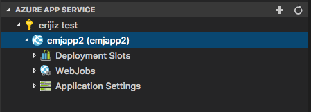
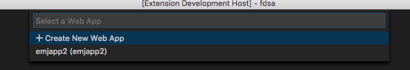
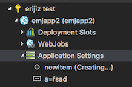

# VSCode Azure SDK for Node.js - UI Tools (Preview)

This package provides common Azure UI elements for VS Code extensions:

- [Telemetry and Error Handling](#telemetry-and-error-handling): Displays error messages and adds telemetry to commands/events.
- [AzExtTreeDataProvider](#azure-extension-tree-data-provider): Displays an Azure Explorer with Azure Subscriptions and child nodes of your implementation.
- [AzExtTreeFileSystem](#azure-extension-tree-file-system): A virtual file system that supports viewing and editing single files in Azure.

> NOTE: This package throws a `UserCancelledError` if the user cancels an operation. If you do not use `registerCommand`, you must handle this exception in your extension.

## Telemetry and Error Handling

Use `registerCommand`, `registerEvent`, or `callWithTelemetryAndErrorHandling` to consistently display error messages and track commands with telemetry. You must call `registerUIExtensionVariables` first in your extension's `activate()` method. The first parameter of the function passed in will always be an `IActionContext`, which allows you to specify custom telemetry and describes the behavior of this command. The simplest example is to register a command (in this case, refreshing a node):

```typescript
registerUIExtensionVariables(...);
registerCommand('yourExtension.Refresh', (context: IActionContext, node: AzExtTreeItem) => {
    context.telemetry.properties.customProp = "example prop";
    context.telemetry.measurements.customMeas = 49;
    node.refresh();
});
```

Here are a few of the benefits this provides:

- Parses Azure errors of the form `{ "Code": "Conflict", "Message": "This is the actual message" }` and only displays the 'Message' property
- Displays single line errors normally and multi-line errors in the output window
- Tracks multiple properties in addition to the [common extension properties](https://github.com/Microsoft/vscode-extension-telemetry#common-properties):
  - result (Succeeded, Failed, or Canceled)
  - duration
  - error

You can also register events. By default, every event is tracked in telemetry. It is _highly recommended_ to leverage the IActionContext.telemetry.suppressIfSuccessful parameter to filter only the events that apply to your extension. For example, if your extension only handles `json` files in the `onDidSaveTextDocument`, it might look like this:

```typescript
registerEvent(
  "yourExtension.onDidSaveTextDocument",
  vscode.workspace.onDidSaveTextDocument,
  async (context: IActionContext, doc: vscode.TextDocument) => {
    context.telemetry.suppressIfSuccessful = true;
    if (doc.fileExtension === "json") {
      context.telemetry.suppressIfSuccessful = false;
      // custom logic here
    }
  }
);
```

### Workflow telemetry (unreleased)

`initializeWorkflowTelemetry` opts an action into schema `workflowSchemaVersion=1`.
It is additive: existing event names, `result` (`Succeeded`/`Failed`/`Canceled`), error
handling and command return values are unchanged. Finalization occurs in
`callWithTelemetryAndErrorHandling` (including registered commands/events), not on
process exit. An abandoned process has no inferred terminal event.

```typescript
initializeWorkflowTelemetry(context, {
    workflow: 'createProject',
    command: 'createNewProject',
    stepNames: ['selectRuntime']
});
await withTelemetryStage(context, { stage: 'projectCreation' }, async () => {
    await createProject();
});
```

The finite types and exact accepted labels are exported in `index.d.ts`:
`WorkflowName`, `WorkflowCommand`, `WorkflowStage`, `WorkflowOutcome`,
`WorkflowCancelReason`, `WorkflowFailureCategory`, `WorkflowFailureCode`,
`WorkflowTelemetryOptions`, `WorkflowTelemetryDetails`, `WorkflowTelemetryStage`,
`WorkflowUserWaitTimer`, `WorkflowNetworkCategory`, `DeploymentMechanism` and `DeploymentStatus`.

| Payload | Meaning |
| --- | --- |
| `workflow`, `command` | Bounded **root** operation labels, not arbitrary VS Code command IDs. |
| `workflowRunId` | Generated root correlation UUID. |
| `attemptId`, `parentAttemptId`, `isWorkflowRoot` | Generated record identity, parent linkage and explicit root marker. Stages/nested actions are not additional user attempts. |
| `stage`, `stepId` | Bounded scope and registered static step identity. Root/action scope is `workflow`. |
| `outcome` | `succeeded`, `failed`, `canceled`, `handedOff`, `blocked` or `unknown`. A gallery handoff is not successful creation or dismissal. |
| `cancelReason`, `failureCategory`, `failureCode` | Optional finite diagnostics. No messages, paths, prompts, resource identifiers, URLs or response bodies are copied into new fields. |
| `retryable` | Optional explicitly known boolean, not inferred from arbitrary errors or a changed retry policy. |
| `retryCount`, `recoveredAfterRetry` | Observed extension-owned retries and proven recovery, not SDK-internal retries or configured retry limits. |
| `deploymentMechanism`, `deploymentStatus`, `httpStatus`, `networkCategory` | Optional bounded facts. HTTP is only `1xx` through `5xx`; network classification reads structured codes, never message text. |
| `workflowDuration`, `activeDuration`, `userWaitDuration` | Seconds within the emitted record's observed scope. Stage events also use `duration`; command `duration` retains its existing full-action meaning. |
| `timingScope`, `userWaitTiming` | `observed`; wait timing is `available` only when an interval was actually observed, otherwise `unavailable` and the wait measurement is omitted. |

`activeDuration` is observed elapsed time excluding the union of explicitly measured
user-wait intervals, **not CPU time**. It includes extension/network/polling delays and
any uninstrumented waits. It is not a claim that all user think time is observable.
Where wait intervals exist, active plus user-wait reconciles with `workflowDuration`.
Nested/overlapping intervals are counted once. Timers are idempotent and open
intervals are clipped at the observed scope end on failure/cancellation.

Use `startWorkflowUserWait(context)` only around extension-owned visible interaction
and dispose it in `finally`. Built-in user input records visible waits; quick-pick
loading and validation after acceptance are not counted as waiting for the user.
Notification responses that happen after command completion are not root wait time.

For a nested action with a **new telemetry object**, use
`initializeWorkflowTelemetry(child, options, parent)`. Do not alias parent telemetry
objects or copy their root marker as authoritative. Initialization replaces inherited
normalized snapshots with the child's generated identity and `isWorkflowRoot=false`.
A later detached child retains correlation, but cannot rewrite the already finalized
root's outcome, duration, retry summary or deployment facts. Its measurements are
local; the earlier root snapshot does not claim to include later diagnostics.

`setWorkflowOutcome` records an explicit terminal decision without changing legacy
`result` or throwing. Preserve existing control flow: e.g. mark `handedOff` with
`templateGallery`, then retain the existing `UserCancelledError` to stop classic
execute steps. Explicit handoff, blocked-prerequisite and failed-task outcomes survive
the legacy cancellation handler. A subsequent real error replaces provisional
`unknown`/`succeeded`, not a known handoff/blocked decision.

`withTelemetryStage` emits privacy-safe `workflowStage` child events and rethrows the
original exception. Its stage handle's `setOutcome` affects **only that stage**:
a failed predeploy task followed by Deploy Anyway need not fail the root.
`setWorkflowTelemetryDetails` affects the current scope; observed deployment status
and mechanism also reach the live root, without prematurely setting root success.
Thus Azure deployment can be `succeeded` while a later command operation fails.
Suppression flags still apply, and reporter failures set `workflowTelemetryFailed`.

For existing retry loops, use exactly one pattern per actual retry invocation:

- Wrap each invocation with `withTelemetryStage(context, { stage, attempt }, callback)`,
  passing the loop's actual one-based attempt number. First invocation is not a retry.
- Or call `recordWorkflowRetry(context)` at the actual invocation seam, before repeating
  or within the previously failed stage. It records immediately, not a deferred intent.
  The same stage must subsequently succeed to establish recovery. Helpers that first
  look up work must record only after the actual work is found and invoked.

Do not use both for the same invocation. Do not count polling iterations as retries,
add a retry policy, or infer recovery from a nonzero counter. Missing observations
remain omitted, not a successful/zero-valued substitute.

#### Stable wizard step identity

Set `telemetryId` on prompt/execute steps to an extension-authored constant and
register it in `stepNames` (at most 128 names of at most 64 ASCII identifier characters).
Never build this registry from runtime/user/resource/error data. Explicit existing
`stepName` properties are an allowlisted compatibility source after `telemetryId`.
Constructor names are not telemetry identity because bundling can rename them.
UUIDs, paths, URLs and unregistered names fall back to `unknown` or a finite UI kind.

Runtime `id` remains unchanged: UUID allocation, Back navigation, cached inputs,
duplicate filtering and activity identity do not use `telemetryId`. User-input
`stepName` and parsed-error `stepName` can select only registered telemetry names;
descriptions, prompts and runtime UUIDs are never fallback telemetry names.
Even clients without workflow opt-in get bounded wizard/UI `lastStep` fallbacks.
Legacy `result` is unchanged; dashboards relying on old high-cardinality `lastStep`
values must migrate deliberately.

**Release boundary:** this source API is not present in the existing published
`5.0.0` package merely because the working tree retains that version. Local tarballs
verify checked-out source only. A human must publish the new utils
API and update consumers' minimum dependency to its actual released version before
publishing dependent packages. No package publication is performed by these changes.

## Pick tree items (Azure Resources API V2)

The Azure Resources API exposes a `TreeDataProvider` for both the Azure resources view and the Workspace resources view. `azureResourceTreeDataProvider` and `workspaceResourceTreeDataProvider` are exposed by the Azure Resources API.

We've created a set of utilities to provide a tree node picking experience that uses quick pick steps in a wizards.

#### Pick an Azure subscription

```ts
const subscription = await subscriptionExperience(context, api.resources.azureResourceTreeDataProvider);
```

#### Pick an Azure resource

```ts
// pick an Azure Resource, in this case a Function App
const functionApp = await azureResourceExperience(context, api.resources.azureResourceTreeDataProvider, AzExtResourceType.FunctionApp);
```

#### Pick a descendent of an Azure resource

```ts
// pick an Azure Resource, in this case a Function App, and then select a descendant of the Function App, in this case an App Setting item
const functionAppAppSetting = await azureResourceExperience(context, api.resources.azureResourceTreeDataProvider, AzExtResourceType.FunctionApp, {
    include: ['appSettingContextValue']
});
```

#### Pick a workspace item

```ts
// pick an item based on context value
const item = await contextValueExperience(context, api.resources.workspaceResourceTreeDataProvider, {
    include: ['itemContextValue']
});
```

### Run a wizard with custom pick steps

If you more granular control over the quick pick steps in the wizard, you can use `runQuickPickWizard` to run a fully customizable quick pick wizard. Here's an example of picking a Function App using `runQuickPickWizard`.

```ts

import { runQuickPickWizard, QuickPickAzureSubscriptionStep, QuickPickGroupStep, QuickPickAzureResourceStep } from '@microsoft/vscode-azext-utils';

const tdp = ext.rgApiV2.resources.azureResourceTreeDataProvider;

const functionApp = await runQuickPickWizard(context, {
    promptSteps: [
        // first step: pick a subscription
        new QuickPickAzureSubscriptionStep(tdp),
        // second step: pick a group, if we are grouped by resource type, pick function apps automatically
        new QuickPickGroupStep(tdp, {
            groupType: [AzExtResourceType.FunctionApp],
        }),
        // third step: pick a resource, in this case a function app
        new QuickPickAzureResourceStep(tdp, {
            resourceTypes: [AzExtResourceType.FunctionApp],
            skipIfOne: false,
        }, {
            placeHolder: 'Select a Function App',
        }),
    ]
});
```

## Azure Extension Tree Data Provider



### Display Azure Resources

Follow these steps to create your basic Azure Tree:

1. Create an `AzExtTreeItem` (or `AzExtParentTreeItem`) describing the items to be displayed under your subscription:

   ```typescript
   export class WebAppTreeItem extends AzExtTreeItem {
     public static contextValue: string = "azureWebApp";
     public readonly contextValue: string = WebAppTreeItem.contextValue;
     private readonly _site: Site;
     constructor(parent: AzExtParentTreeItem, site: Site) {
       super(parent);
       this._site = site;
     }

     public get id(): string {
       return this._site.id;
     }

     public get label(): string {
       return this._site.name;
     }
   }
   ```

1. Create a `SubscriptionTreeItemBase` that provides the tree items you just implemented. It must implement at least `hasMoreChildrenImpl` and `loadMoreChildrenImpl`:

   > NOTE: Methods suffixed with `Impl` should not be called directly - just implemented.

   ```typescript
   export class SubscriptionTreeItem extends SubscriptionTreeItemBase {
       private _nextLink: string | undefined;

       public hasMoreChildrenImpl(): boolean {
           return this._nextLink !== undefined;
       }

       public async loadMoreChildrenImpl(clearCache: boolean, _context: IActionContext): Promise<WebAppTreeItem[]> {
           if (clearCache) {
               this._nextLink = undefined;
           }

           const client: WebSiteManagementClient = createAzureClient(this.root, WebSiteManagementClient);
           const webAppCollection: WebAppCollection = this._nextLink === undefined ?
               await client.webApps.list() :
               await client.webApps.listNext(this._nextLink);
           this._nextLink = webAppCollection.nextLink;
           return webAppCollection.map((site: Site) => new WebAppTreeItem(this, site)));
       }
   }
   ```

1. Create an `AzureAccountTreeItemBase` that provides the subscriptions you just implemented. It must implement at least `createSubscriptionTreeItem`:
   ```typescript
   export class AzureAccountTreeItem extends AzureAccountTreeItemBase {
     public createSubscriptionTreeItem(root: ISubscriptionContext): SubscriptionTreeItemBase {
       return new SubscriptionTreeItem(this, root);
     }
   }
   ```
1. Finally, set up the tree in your extension's `activate()` method. Instantiate an `AzureAccountTreeItem` and add it to `context.subscriptions` since it's a disposable. Then instantiate an `AzExtTreeDataProvider`, passing in your root tree item and the `loadMoreCommandId` (which maps the 'Load More...' node to the command registered by your extension).
   ```typescript
   const azureAccountTreeItem = new AzureAccountTreeItem();
   context.subscriptions.push(azureAccountTreeItem);
   const treeDataProvider = new AzExtTreeDataProvider(azureAccountTreeItem, "appService.loadMore");
   context.subscriptions.push(vscode.window.createTreeView("azureAppService", { treeDataProvider }));
   ```

### Advanced Scenarios

#### Non-Azure resources

If your tree displays non-Azure resources you can either provide a different root tree item in the constructor of `AzExtTreeDataProvider`, or override `loadMoreChildrenImpl` in `AzureAccountTreeItemBase` to add items at the same level as subscriptions. The non-Azure tree items can extend `AzExtTreeItem` and `AzExtParentTreeItem` (a tree item for an **Az**ure **Ext**ension) which are more generic than `AzureTreeItem` and `AzureParentTreeItem`.

#### Tree Item Picker

The above steps will display your Azure Resources, but that's just the beginning. Let's say you implemented a `browse` function on your `WebAppTreeItem` that opened the Web App in the browser. In order to make that command work from the VS Code command palette, use the `showTreeItemPicker` method:

```typescript
registerCommand('appService.Browse', async (context: IActionContext, treeItem?: WebAppTreeItem) => {
    if (!treeItem) {
        treeItem = await treeDataProvider.showTreeItemPicker(WebAppTreeItem.contextValue, context);
    }

    treeItem.browse();
}));
```

#### Create Child Item

For a more advanced scenario, you can also implement the `createChildImpl` method on your `AzExtParentTreeItem`. This will ensure the 'Create' option is displayed in the node picker and will automatically display a 'Creating...' item in the tree:

 

```typescript
export class WebAppProvider extends SubscriptionTreeItem {
  public async createChildImpl(context: ICreateChildImplContext): Promise<WebAppTreeItem> {
    const webAppName = await vscode.window.showInputBox({ prompt: "Enter the name of your new Web App" });
    context.showCreatingTreeItem(webAppName);
    const newSite: Site | undefined = await createWebApp(webAppName, this.root);
    return new WebAppTreeItem(newSite);
  }
}
```

### Debug Telemetry

If the environment variable `DEBUGTELEMETRY` is set to a non-empty, non-zero value, then the telemetry reporter used internally by this package will not attempt to send any data.  If the value is 'verbose' or 'v', the telemetry will not be sent but will be displayed on the console window.

### Display Context Values

With environment variable `DEBUGTELEMETRY` set to 'v' and settings.json field `"azureTools.showContextValues": true`, tooltips on treeItems will display their `contextValue` instead of their conventional tooltip.  Set this value to false if you wish to display the normal tooltip while in debug mode.  The change in tooltip will then be reflected after the next user action is made through the tree GUI.

## Azure Extension Tree File System

> NOTE: This replaces `BaseEditor`, which has been deprecated

A virtual file system that supports viewing and editing single files in Azure. It is _not_ meant to be used as a fully-fledged file system. For now it is based around AzExtTreeItems, but it may be extended to support generic items of any kind if the need arises. Follow these basic steps:

1. Create a new class that extends `AzExtTreeFileSystem` for your file system. The primary purpose of this class is to describe how the file content is retrieved and updated. See the documentation on the class's types for more information.
1. Set up the file system in your extension's `activate()` method:

    ```typescript
    const fileSystem = new ExampleFileSystem(exampleTree);
    context.subscriptions.push(vscode.workspace.registerFileSystemProvider('exampleScheme', fileSystem));
    ```
1. Make sure the file system is listed in the `activationEvents` of your extension's package.json:

    ```
    "activationEvents": [
        "onFileSystem:exampleScheme"
    ]
    ```

Use `fileSystem.showFile(item, options)` to let VS Code choose the editor for the file name, including image and other binary/custom editors. It registers the same item and URI as `showTextDocument`, which remains available when a text editor is explicitly required. File system implementations must return the original bytes from `readFileImpl` and upload the supplied bytes from `writeFileImpl` without decoding them as text.

For a read-only byte snapshot, use `openReadOnlyFile({ label, fullId }, bytes, options)`. The label retains the file extension for editor selection; the full ID distinguishes resources, including tenants, subscriptions, and slots. Its backing file system is registered read-only and rejects writes. Existing `openReadOnlyContent` and JSON helpers remain text-only.

## License

[MIT](LICENSE.md)
